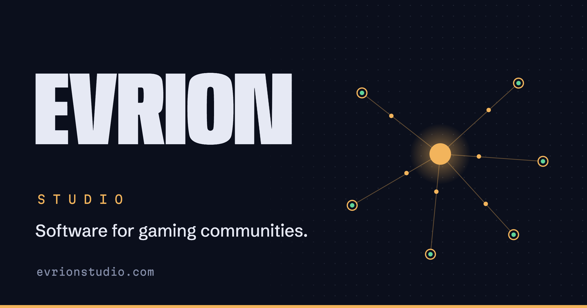

  

### Bots, panels and websites for gaming communities.

Evrion Studio builds and runs tools for Discord and gaming communities, from the first idea to production. Every project runs on our own infrastructure and is monitored around the clock.

| Project | What it does | Status |
|---|---|---|
| **[Tripwire](https://tripwire.evrionstudio.com)** | Protects Discord servers from scams, spam bots and compromised accounts. | Live |
| **[Settingsreport](https://settingsreport.de)** | Reporting portal and moderation panel with case files and evidence management. | Live |
| **[UMBRA](https://discord.gg/h3qXQZjECX)** | Discord server with custom bots and a team panel. | Live |
| **DOMUS** | Builds complete Discord servers at the push of a button. | Paused |

**Stack** · JavaScript · TypeScript · Node.js · discord.js · Express · PostgreSQL · Redis · Linux · nginx · Cloudflare

**Contact** · support@evrionstudio.com · [evrionstudio.com](https://evrionstudio.com) · [Status](https://evrionstudio.com/status)

The source code of our products is private.
